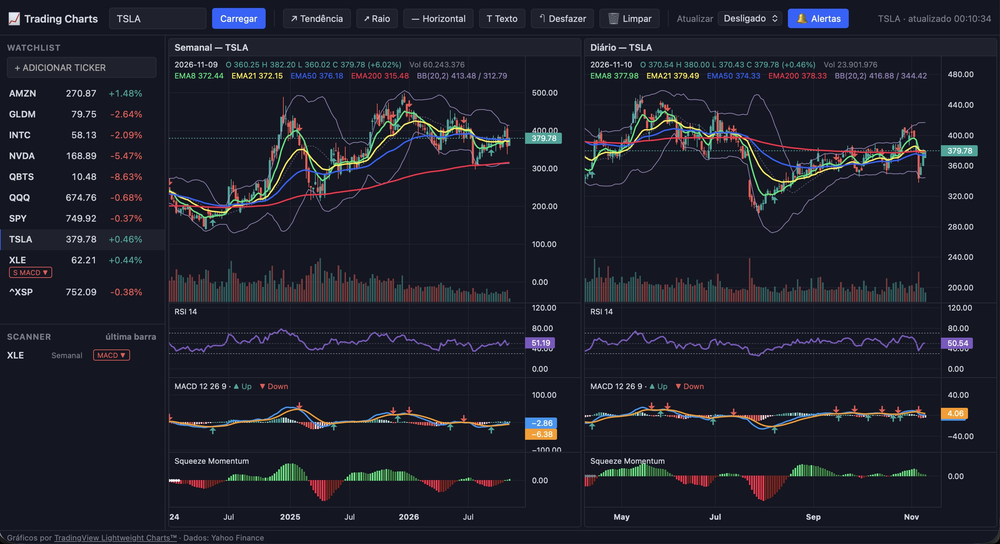

# Trading Charts

Weekly + Daily charts side by side, TradingView style, for the US stock market.

## Features

- **Weekly** and **Daily** charts side by side, with zoom, scrolling and crosshair synced across panes
- **Draggable splitter** between weekly and daily to adjust each chart's width (double-click resets to 50/50)
- Data from Yahoo Finance (yfinance). E.g. `AAPL`, `SPY`, `QQQ`, `NVDA`, `^GSPC`
- **Watchlist** sidebar (alphabetical order) with price, daily change and signals
- **Scanner**: signals that occurred on the last bar (Daily/Weekly) for the watchlist tickers
- **Alerts 🔔**: browser notification + in-page toast when a new scanner signal appears
  (with auto-refresh off, the scanner runs every 5 min during market hours)
- **Auto-refresh** (1/5/15 min), only while the market is open (Mon–Fri, 9:30–16:15 New York time)
- **Drawings** per ticker: trend line, ray (trend line extended 30 bars ahead),
  horizontal line (shown on both weekly and daily) and text note. Undo / Clear; Esc cancels
- Watchlist and drawings are saved in `data/` (mounted as a volume in Docker)

## Indicators

### Price chart

| Indicator | Parameters | Color | What it shows |
|---|---|---|---|
| **Candles** | — | green / red | Open, high, low and close of each period. Green = closed above the open; red = closed below. |
| **Volume** | — | green / red | Volume traded in the period, at the bottom of the chart, colored like its candle. High volume confirms the strength of a move. |
| **EMA 8** | 8 periods | 🟢 green | Short exponential moving average: very short-term trend, reacts quickly to price. |
| **EMA 21** | 21 periods | 🟡 yellow | Short-term trend. EMA 8 / EMA 21 crossovers often signal a change in pace. |
| **EMA 50** | 50 periods | 🔵 blue | Medium-term trend; often acts as support/resistance. |
| **EMA 200** | 200 periods | 🔴 red | Long-term trend. Price above = bullish bias; below = bearish bias. |
| **Bollinger Bands** | 20 periods, 2 std dev | lilac (dashed basis) | 20-period average with bands at 2 standard deviations. Narrow bands = low volatility (a big move may follow); price touching the bands = relative extremes. |
| **MACD arrows** | — | ▲ green / ▼ red | The same MACD crossover signals (below), repeated over the candles. |

> EMA = *Exponential Moving Average*: gives more weight to recent prices than a simple average.

### RSI 14 — Relative Strength Index

Purple line from 0 to 100 measuring the strength of gains versus losses over the last 14 periods (Wilder's method).

- **Above 70**: overbought — price rose a lot, fast
- **Below 30**: oversold — price fell a lot, fast
- **50 line**: divides bullish from bearish momentum

### MACD (12, 26, 9)

Measures the difference between two exponential moving averages to identify trend and momentum.

- **MACD line** (blue): EMA 12 − EMA 26
- **Signal line** (orange): EMA 9 of the MACD line
- **Histogram**: MACD − signal
  - strong green = positive and growing · light green = positive and losing strength
  - strong red = negative and falling · light pink = negative and losing strength
- **▲ Up** (green): MACD crosses the signal line **upward** — bullish momentum
- **▼ Down** (red): MACD crosses the signal line **downward** — bearish momentum

### Squeeze Momentum (LazyBear)

Identifies periods of **volatility compression** (price "building up energy") and the likely direction when it is released.

A *squeeze* happens when the Bollinger Bands (20) are **inside** the Keltner Channel (20, 1.5 × ATR).

**Dots on the zero line:**
- ⚪ **white** = squeeze on — compressed volatility, a strong move may be near
- ⚫ **gray** = squeeze released — the compression has ended (the "fire")
- 🔵 **blue** = no squeeze

**Histogram (momentum)** — linear regression of price relative to the middle of the last 20 periods' range:
- light green = positive momentum increasing · dark green = positive decreasing
- red = negative momentum increasing · maroon = negative decreasing

The calculation follows LazyBear's original TradingView script (including its use of 1.5 std dev for the inner squeeze Bollinger Bands), so values match TradingView.

### Scanner signals

The scanner checks only the **last bar** (today on daily, this week on weekly). In the watchlist the prefix shows the timeframe: **D** = Daily, **W** = Weekly.

| Signal | Meaning |
|---|---|
| **MACD ▲** | MACD crossed above the signal line |
| **MACD ▼** | MACD crossed below the signal line |
| **Squeeze ▲** | Squeeze released with positive momentum (likely upside breakout) |
| **Squeeze ▼** | Squeeze released with negative momentum (likely downside breakout) |

> During market hours the last bar is still forming, so a signal may appear and disappear until the close.

## Run with Docker

    docker compose up -d --build

Open http://localhost:8000

## Run without Docker

    ./run_local.sh

---

*Study/analysis tool. Not investment advice. Yahoo Finance data may be delayed by ~15 minutes.*
